<div align="center">


# GoalVault

### Small amounts. Big goals.

**A mobile-first savings app that puts money aside automatically, a little at a time, for the things you want: a new laptop, a phone, a trip with friends.**

[](https://github.com/JTarakRam/goalvault/actions/workflows/ci.yml)


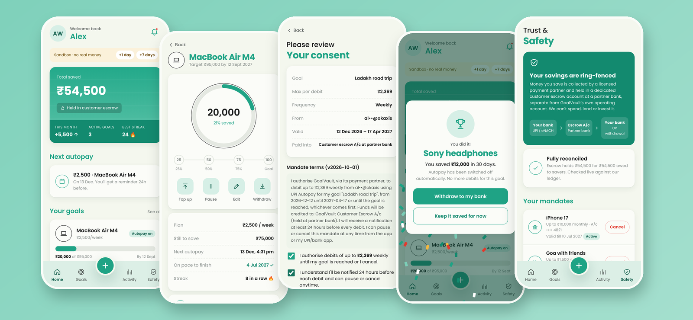

</div>

---

## Why GoalVault?

Most people don't fail to save because they can't. They fail because saving takes a decision every single time. GoalVault turns it into a habit you set up once:

1. **Pick a goal.** "MacBook Air, ₹95,000, by September."
2. **Get a plan.** GoalVault works out a small daily, weekly or monthly amount that gets you there on time.
3. **Approve once.** Turn on UPI Autopay or a bank e-mandate with your UPI PIN, in your own UPI or bank app.
4. **Watch it grow.** Progress rings, milestones and streaks keep you going. You get a heads-up before every debit.
5. **Buy it.** When the goal is reached, Autopay switches itself off and the money goes back to your bank, ready to spend.

It's built around **trust and transparency**. Your money sits in a ring-fenced escrow account, separate from the company's own money. You approve exactly what can be debited, and you can pause, edit or withdraw at any time with no fees or penalties.

---

## Features

### 🎯 Goals with a plan that fits

Choose a category, a target and a date. GoalVault suggests a contribution per period, rounded up to the nearest rupee so you never fall short. You can change it to whatever suits you.

<table>
  <tr>
    <td align="center">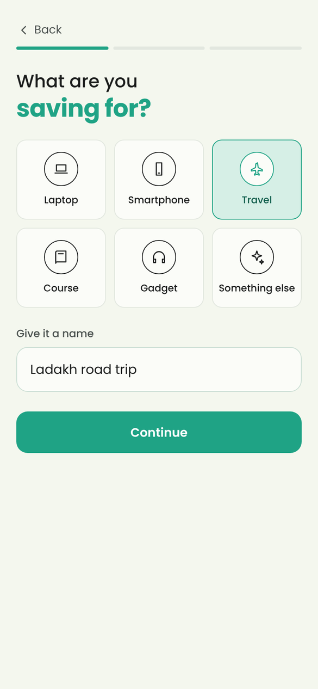<br/><sub><b>What are you saving for?</b></sub></td>
    <td align="center">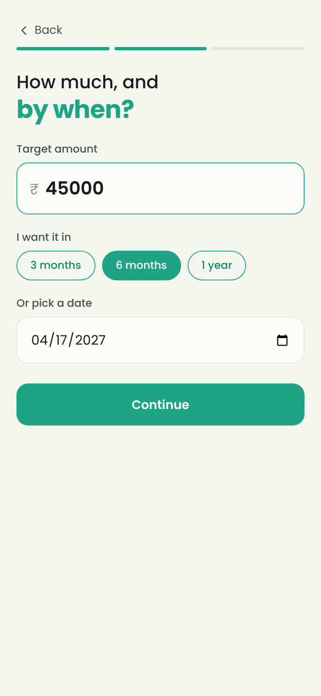<br/><sub><b>How much, and by when?</b></sub></td>
    <td align="center">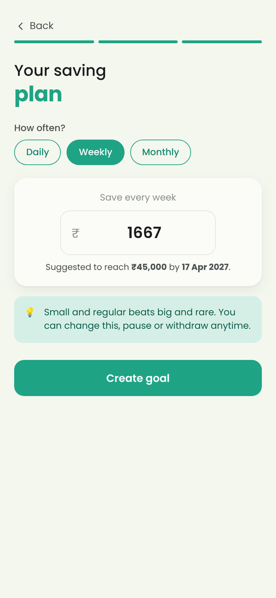<br/><sub><b>Your suggested plan</b></sub></td>
  </tr>
</table>

### 🔁 Automatic savings with consent you can see

* **UPI Autopay** (GPay, PhonePe, Paytm, BHIM…) for up to ₹15,000 per debit, or a **bank e-mandate (eNACH)** for larger amounts.
* The consent screen shows a **plain-language summary** (max amount, frequency, source, validity, where the money goes) **and** the full, versioned mandate text, with two explicit checkboxes.
* You approve **in your own UPI or bank app**. GoalVault never sees your PIN or bank credentials.

<table>
  <tr>
    <td align="center">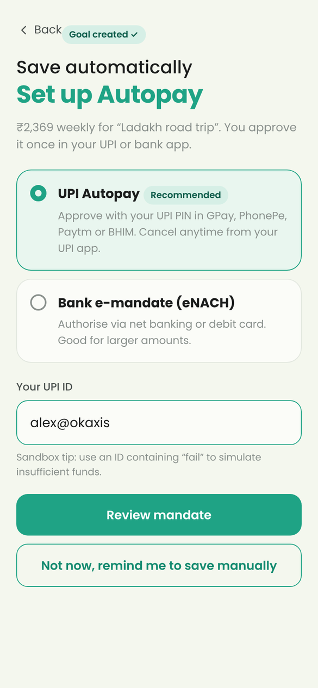<br/><sub><b>Choose how to pay</b></sub></td>
    <td align="center">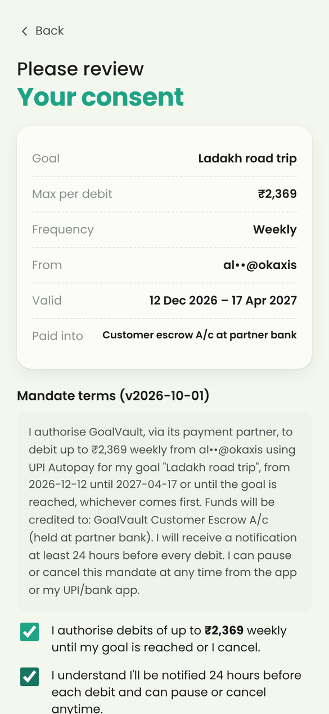<br/><sub><b>Review exactly what you approve</b></sub></td>
    <td align="center">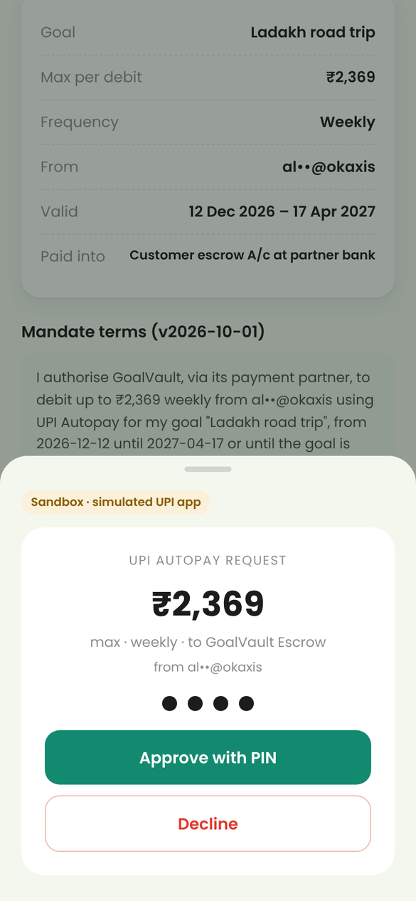<br/><sub><b>Approve with your UPI PIN</b></sub></td>
  </tr>
</table>

### 📈 Progress that motivates

The home screen shows your total saved, this month's savings, active goals and your best streak. Each goal has a progress ring, **25 / 50 / 75 / 100% milestones**, an "on pace to finish by" date and a streak counter.

<table>
  <tr>
    <td align="center">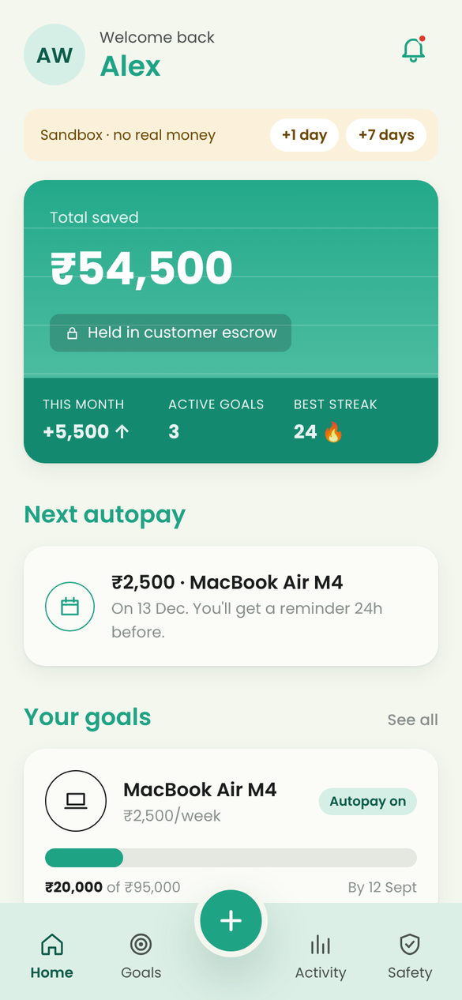<br/><sub><b>Home dashboard</b></sub></td>
    <td align="center">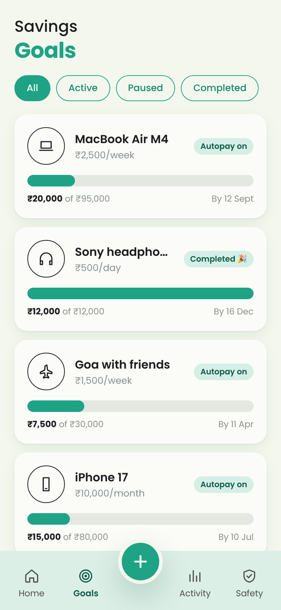<br/><sub><b>All your goals</b></sub></td>
    <td align="center">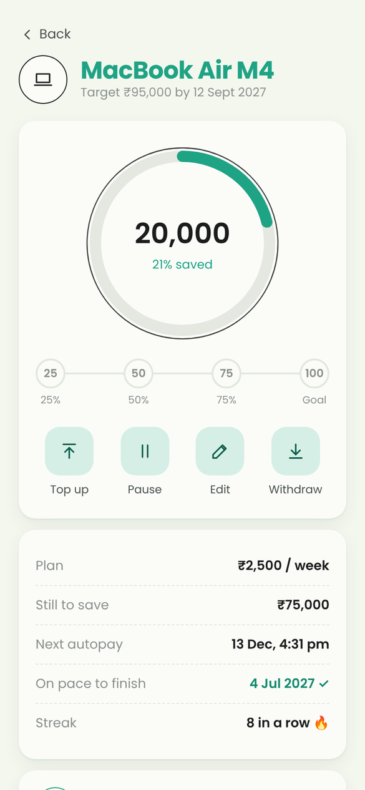<br/><sub><b>Progress ring and milestones</b></sub></td>
  </tr>
</table>

### 🔔 Reminders and 🎉 celebrations

* A **pre-debit notice at least 24 hours before every Autopay debit** (an NPCI requirement), with a reminder that you can pause before then.
* Reminders for goals saved manually, plus notifications for successful and failed debits and for milestones.
* **Confetti when you reach a goal.** Autopay turns itself off and the last debit is capped, so you never save more than your target.

<table>
  <tr>
    <td align="center">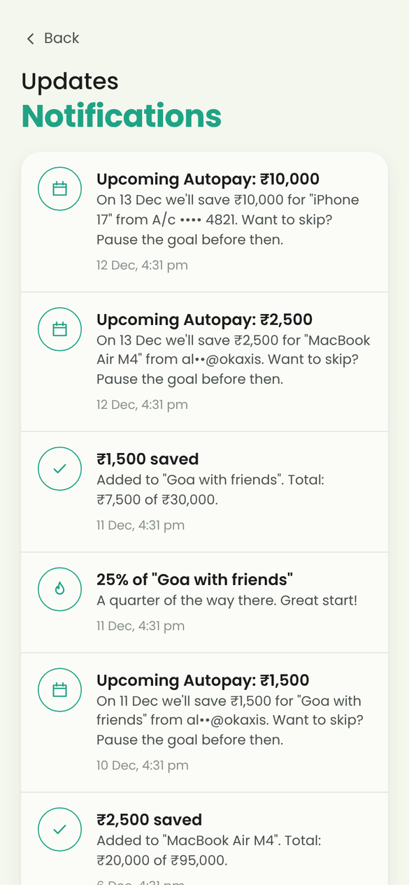<br/><sub><b>Pre-debit notices and updates</b></sub></td>
    <td align="center">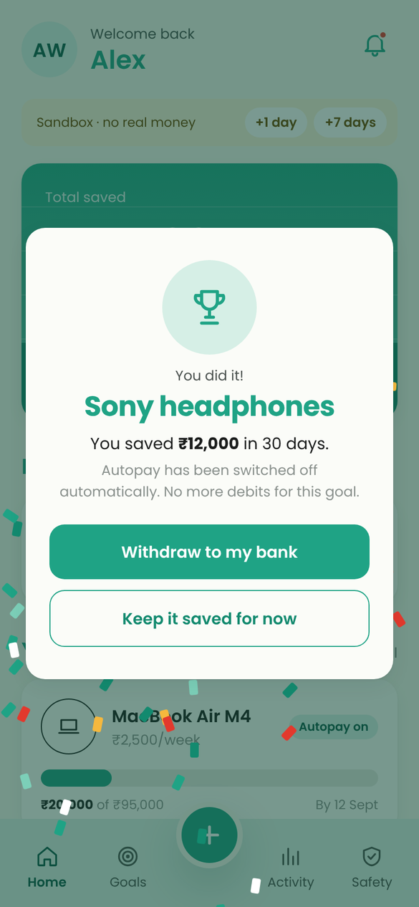<br/><sub><b>Goal reached!</b></sub></td>
    <td align="center">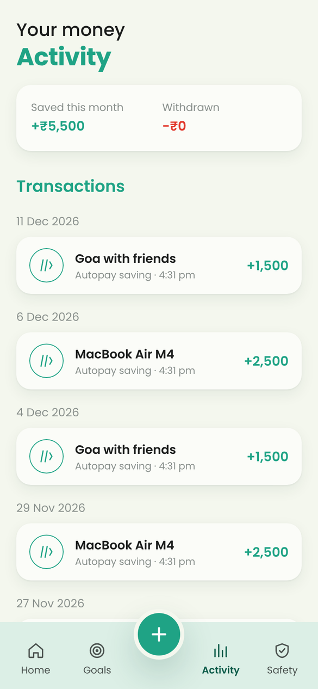<br/><sub><b>Every rupee in and out</b></sub></td>
  </tr>
</table>

### 🕹️ You stay in control

* **Pause / resume** anytime. Debits stop immediately.
* **Edit** the name, target, deadline, amount or frequency. If the change goes beyond what your current mandate allows, GoalVault **cancels it and asks you to approve a new one**. It never quietly debits more.
* **Top up** with a one-time UPI payment.
* **Withdraw** part or all of your savings, with **no fees and no penalty**, only to your own verified bank account.

<table>
  <tr>
    <td align="center">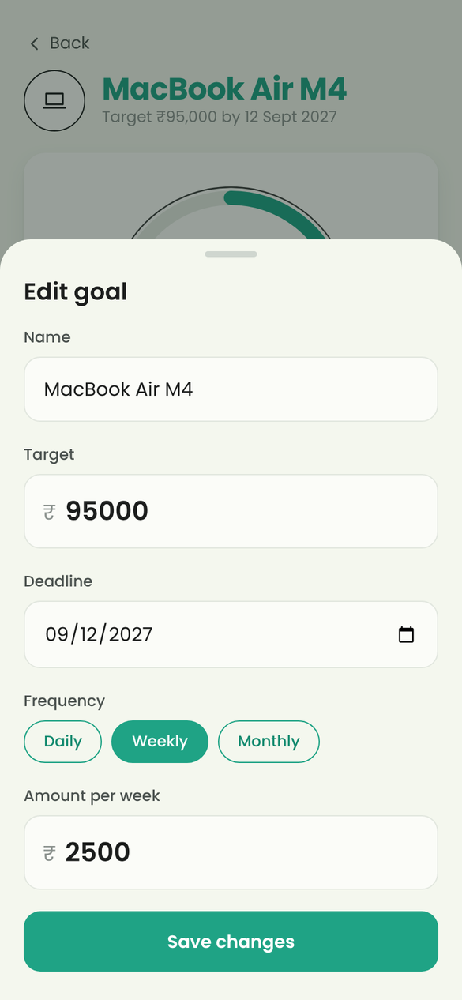<br/><sub><b>Edit your plan</b></sub></td>
    <td align="center">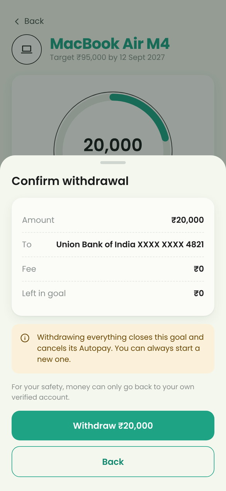<br/><sub><b>Withdraw anytime, ₹0 fee</b></sub></td>
    <td align="center">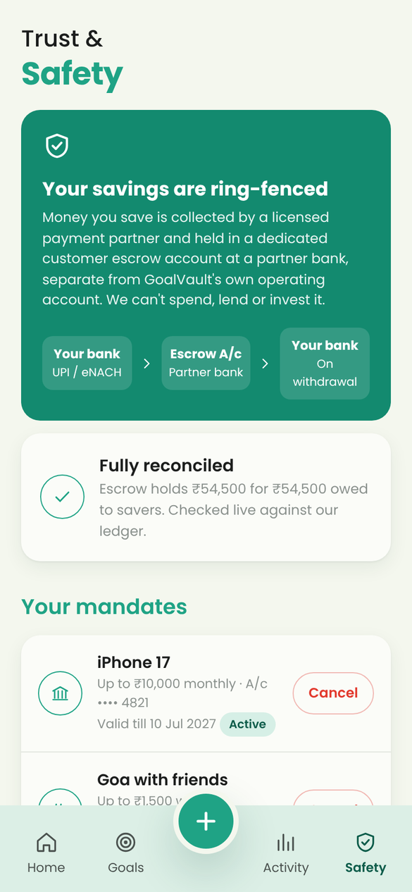<br/><sub><b>Trust & Safety centre</b></sub></td>
  </tr>
</table>

### 🛡️ Trust & Safety centre

One screen that shows how your money is protected: how money flows, a **live check that escrow matches what's owed to savers**, every active mandate with a one-tap **Cancel**, and a history of every consent you've given.

---

## How your money is protected

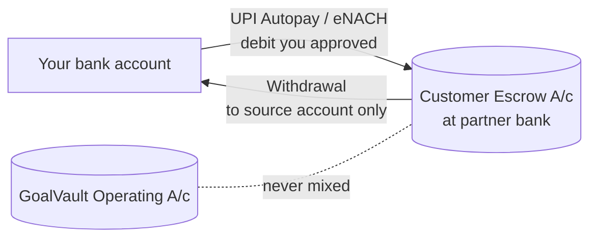

| Principle | How it's built |
|---|---|
| **Ring-fenced funds** | Savings are collected by a licensed payment partner into a dedicated **customer escrow account**. GoalVault's operating account is separate and can't spend, lend or invest customer savings. |
| **Double-entry ledger** | Each contribution debits `asset:escrow_bank` and credits that user's goal liability. Balances are always computed from ledger entries. **Any posting that would mix escrow and operating funds is rejected in code.** |
| **Live reconciliation** | Escrow balance = total owed to customers. The app checks this and shows it to users in the Safety tab. |
| **Debits only within consent** | The mandate cap equals the amount you approved. Raising it requires a new approval. |
| **Notice before every debit** | The scheduler won't run a debit unless the pre-debit notice went out at least 24h earlier. |
| **No double charges** | Every money-moving call needs an idempotency key. Scheduler debits are keyed per goal and cycle. |
| **Verified payment events** | Provider webhooks are HMAC-SHA256 signed and checked in constant time, with a timestamp window, replay protection and an amount cross-check. Balances change **only** through verified events. |
| **Tamper-evident consent** | Every consent stores its version, a SHA-256 hash of the exact text shown, a timestamp, IP and user agent. |
| **Minimal data** | Only masked UPI IDs and account numbers are stored. No card data. |

The regulatory notes (RBI PA guidelines, NPCI Autopay rules, KYC/PMLA, DPDP Act) and the full production checklist are in **[docs/COMPLIANCE.md](docs/COMPLIANCE.md)**.

### Life of an Autopay debit

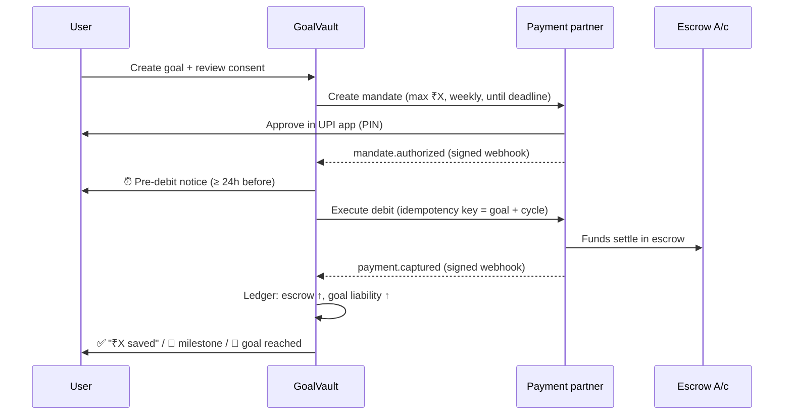

---

## Tech stack

| Layer | Tech |
|---|---|
| **Web app** | React 18, TypeScript, Vite, React Router. Installable PWA, mobile-first design with plain CSS design tokens |
| **API** | Node 22, Express, TypeScript, Zod validation |
| **Payments** | Pluggable `PaymentProvider` interface, plus a built-in **sandbox** that simulates UPI Autopay, eNACH, collections and payouts, including signed webhooks |
| **Storage** | Lightweight JSON store (zero setup), designed to be swapped for Postgres |
| **Testing / CI** | Vitest, plus GitHub Actions (typecheck → test → build) |

**Design:** cream canvas `#F4F7EE`, brand teal `#1FA385`, the Poppins typeface, line-art icons in circles, outlined pill chips, a teal gradient balance card, and a bottom bar with a raised **+** button.

---

## Getting started

**Prerequisites:** Node.js 22+

```bash
git clone https://github.com/JTarakRam/goalvault.git
cd goalvault
npm install
npm run dev
```

* App: **http://localhost:5173**. Open it on your phone via `http://<your-computer-ip>:5173` (same Wi-Fi).
* API: http://localhost:4000

### Take it for a spin (sandbox, no real money)

1. Accept the terms and tap **Create a goal**.
2. Pick a category, target and date, then accept or tweak the suggested plan.
3. Choose **UPI Autopay**, enter any UPI ID such as `alex@okaxis`, review the consent and **Approve with PIN** in the simulated UPI sheet.
   * Use a UPI ID containing `fail` (e.g. `fail@okaxis`) to see how a failed debit is handled.
4. Use the **Sandbox +1 day / +7 days** buttons to fast-forward time. You'll see pre-debit notices, debits, milestones, and finally the 🎉 completion screen.
5. Try **Pause**, **Edit** (raise the amount to trigger re-authorisation), **Top up** and **Withdraw**, then check the **Safety** tab.

### Scripts

| Command | What it does |
|---|---|
| `npm run dev` | Starts the API and the web app with hot reload |
| `npm test` | Runs server unit tests: ledger, scheduler compliance, webhooks, money flows |
| `npm run typecheck` | Type-checks both packages |
| `npm run build` | Production build. `npm start -w server` then serves the API **and** `web/dist` |

### Configuration (`server/.env.example`)

| Variable | Purpose |
|---|---|
| `PORT` | API port (default `4000`) |
| `WEBHOOK_SECRET` | HMAC secret shared with the payment provider |
| `SESSION_SECRET` | Signs session tokens |
| `PAYMENT_PROVIDER` | `sandbox` (the only provider in this repo) |
| `SCHEDULER_INTERVAL_MS` | How often the debit scheduler runs |

In production (`NODE_ENV=production`) the server refuses to start without real secrets.

---

## Project structure

```
goalvault/
├── web/                         # React PWA
│   └── src/
│       ├── screens/             # Home, Goals, NewGoal, Autopay (consent), GoalDetail,
│       │                        # Activity, Alerts, Trust (Safety), Onboarding
│       ├── components/          # Progress ring/bars, milestones, nav, sheet, celebration
│       ├── lib/                 # API client (idempotency keys), formatting, app state
│       └── styles.css           # design tokens & components
├── server/
│   ├── src/
│   │   ├── service.ts           # goals, mandates, debits, withdrawals, scheduler, notifications
│   │   ├── ledger.ts            # double-entry ledger, escrow/operating guard, reconciliation
│   │   ├── consent.ts           # versioned consent texts
│   │   ├── money.ts             # paise maths, schedules, suggestions, projections
│   │   ├── auth.ts              # signed session tokens
│   │   ├── payments/            # provider interface, sandbox, webhook signing/verification
│   │   └── routes/api.ts        # REST API + Zod validation
│   └── test/                    # Vitest suite
└── docs/
    ├── COMPLIANCE.md            # fund safety, consent, regulations, launch checklist
    └── screenshots/
```

### API at a glance

| Method & path | Description |
|---|---|
| `GET /api/me/summary` | Dashboard: totals, goals, upcoming debits, unread count |
| `POST /api/me/terms` | Record acceptance of the terms and fund-safety disclosure |
| `POST /api/goals` · `GET/PATCH /api/goals/:id` | Create, read, edit a goal |
| `POST /api/goals/:id/pause` · `/resume` | Pause or resume saving |
| `GET /api/goals/:id/mandate/preview` | Exact consent text and summary to show before approval |
| `POST /api/goals/:id/mandate` | Create a mandate (explicit consent + version required) |
| `POST /api/goals/:id/contribute` | One-time top-up (`Idempotency-Key` header required) |
| `POST /api/goals/:id/withdraw` | Withdraw to the verified bank account (`Idempotency-Key` header required) |
| `POST /api/mandates/:id/revoke` | Cancel Autopay |
| `GET /api/transactions` · `/notifications` · `/trust` | Activity, alerts, Safety centre data |
| `POST /api/webhooks/payments` | Signed payment-provider webhooks |

---

## Testing

```bash
npm test
```

The suite checks the rules that matter most for a money app:

* ✅ Unbalanced postings and escrow/operating mixing are rejected
* ✅ Webhook signatures: tampering, wrong secret and stale timestamps are rejected; replayed events are ignored
* ✅ Mandates can't be created without explicit consent, and the consent is hashed
* ✅ **No debit before the 24h pre-debit notice**
* ✅ The final debit is capped, the goal completes, Autopay is revoked, milestones fire and escrow stays reconciled
* ✅ Pausing stops debits; failed debits notify without touching the ledger
* ✅ Raising the amount above the mandate requires re-authorisation
* ✅ Withdrawals are idempotent and limited to the available balance

---

## Roadmap to production

This repo is a complete, working product with a **sandbox payment provider**. To take real money:

- [ ] Partner with a licensed Payment Aggregator / sponsor bank for UPI Autopay, eNACH and payouts, open the customer escrow account, and implement its `PaymentProvider`
- [ ] KYC before the first collection; AML/PMLA monitoring
- [ ] Postgres with serializable transactions for ledger writes, plus an outbox for notifications
- [ ] Phone OTP auth, device binding, step-up auth for withdrawals
- [ ] Push / SMS / email delivery for pre-debit notices
- [ ] Daily escrow-vs-bank-statement reconciliation with alerts

Details are in [docs/COMPLIANCE.md](docs/COMPLIANCE.md).

---

## Disclaimer

GoalVault savings are **not a bank deposit and do not earn interest**. The included payment provider is a **sandbox**: no real money moves. Nothing in this repository is legal or financial advice. Check the regulatory approach with qualified counsel and your banking partners before launch.

<div align="center">
<br/>
Made with 💚 for everyone saving up for something.
</div>
